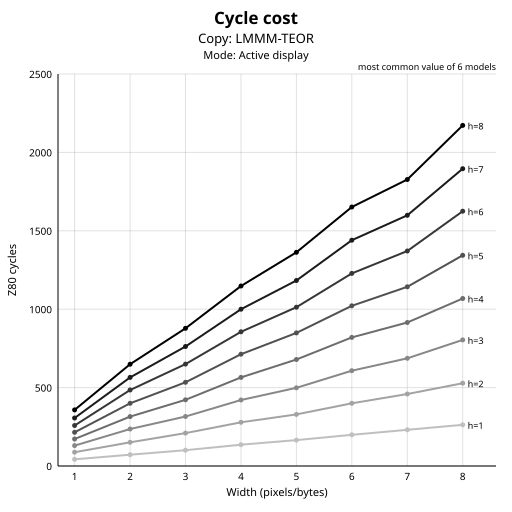
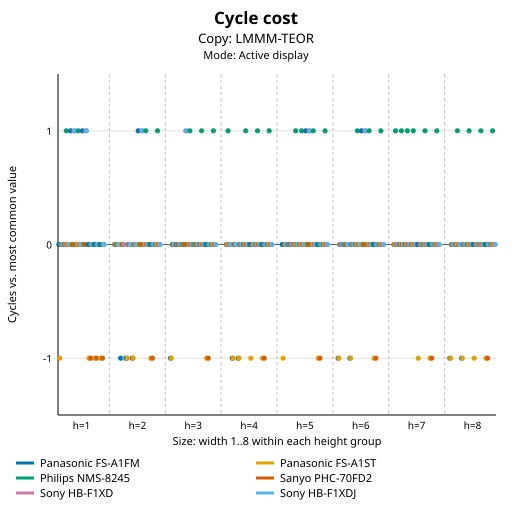
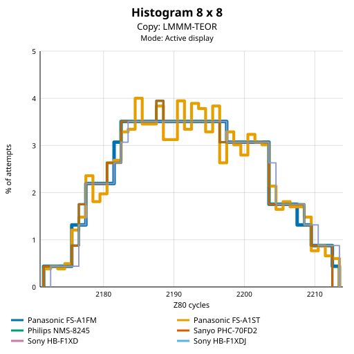

# cmdcycles | report V9938 command time w/histogram

## What it does

`cmdcycle` runs the VDP commands HMMV, LMMV, HMMM, LMMM, YMMM and LINE in 64 sizes
(1..8 × 1..8 pixels/bytes) and measures how long each one takes, in Z80 cycles. The
results are meant as a reference for VDP emulation.

- Measured in the active display area, under three conditions, because display and
  sprites [change the timing](https://openmsx.org/vdp-vram-timing/vdp-timing.html):
  display + sprites, display without sprites, no display.
- Systems with a T9769 MSX engine (MSX2+, turbo R and some MSX2 such as the FS-A1FM)
  [add a wait cycle](https://www.msx.org/forum/msx-talk/development/extra-vdp-wait-cycles?page=0)
  to every VDP I/O. This is detected, and the results include that +1 so they can be
  compared directly with other systems.
- Works on drifting CPU/VDP clocks too (turbo R).

## Test results

> **All machines agree within one cycle, in every size and every mode.**
> V9938 or V9958, with or without T9769, PAL or NTSC, with or without clock drift.
>
> **That one cycle is not a difference between models.** The same machine can show either
> value: after a power cycle the Philips gave 2172 instead of 2173 for LMMM 8x8. Most
> likely the cause is the phase between the CPU and VDP clocks, which is set at power-on
> (the CPU clock is the VDP clock divided by 6). Within one session, results repeat
> exactly. So an emulator that is within one cycle is as close as real machines are to
> each other.

Measured on these machines, each with k = 8: the cycle table and the 8x8 histogram,
in three modes: **1** display and sprites on, **2** display on, sprites off, **3** no
display (the options `-1`, `-2`, `-3`).

| Model | PAL | Clock drift | V9938 | V9958 | T9769 | Mode 1 | Mode 2 | Mode 3 |
| --- | :---: | :---: | :---: | :---: | :---: | :---: | :---: | :---: |
| Sony HB-F1XD |  |  | ✓ |  |  | [cycles](data/S-1N8.MD) \| [histogram](data/S-1G888.MD) | [cycles](data/S-2N8.MD) \| [histogram](data/S-2G888.MD) | [cycles](data/S-3N8.MD) \| [histogram](data/S-3G888.MD) |
| Sony HB-F1XDJ |  |  |  | ✓ |  | [cycles](data/S2-1N8.MD) \| [histogram](data/S2-1G888.MD) | [cycles](data/S2-2N8.MD) \| [histogram](data/S2-2G888.MD) | [cycles](data/S2-3N8.MD) \| [histogram](data/S2-3G888.MD) |
| Philips NMS-8245 | ✓ |  | ✓ |  |  | [cycles](data/N-1N8.MD) \| [histogram](data/N-1G888.MD) | [cycles](data/N-2N8.MD) \| [histogram](data/N-2G888.MD) | [cycles](data/N-3N8.MD) \| [histogram](data/N-3G888.MD) |
| Panasonic FS-A1FM |  |  | ✓ |  | ✓ | [cycles](data/PF-1N8.MD) \| [histogram](data/PF-1G888.MD) | [cycles](data/PF-2N8.MD) \| [histogram](data/PF-2G888.MD) | [cycles](data/PF-3N8.MD) \| [histogram](data/PF-3G888.MD) |
| Sanyo PHC-70FD2 |  |  |  | ✓ | ✓ | [cycles](data/SY-1N8.MD) \| [histogram](data/SY-1G888.MD) | [cycles](data/SY-2N8.MD) \| [histogram](data/SY-2G888.MD) | [cycles](data/SY-3N8.MD) \| [histogram](data/SY-3G888.MD) |
| Panasonic FS-A1ST |  | ✓ |  | ✓ | ✓ | [cycles](data/P-1N8.MD) \| [histogram](data/P-1G888.MD) | [cycles](data/P-2N8.MD) \| [histogram](data/P-2G888.MD) | [cycles](data/P-3N8.MD) \| [histogram](data/P-3G888.MD) |

*Clock drift*: CPU and VDP run from separate clocks, which drift apart.

All reports are in [data/](data/).

[comparison.md](comparison.md) shows all commands and modes side by side, as charts with
one colour per machine.

## How it measures

A command is started (OUT), then after exactly *d* cycles the status is read (IN): is it
done? The result for a size is the smallest *d* at which the command can be done.

A command's duration depends on where in the display line it starts. So every *d* is
tried from all 228 start positions in a line (a *sweep*), with an exact cycle count
between OUT and IN. `-k` repeats the sweep k times (default 1). More sweeps catch rare
cases, at the cost of time.

More detail: [docs/measurement.md](docs/measurement.md).

## Usage

```text
cmdcycle [opt] [sys] > file.md
```

The output is markdown. Redirect it to a file - as there is a lot of information (MSX DOS2 is needed for this).

| Option | |
| --- | --- |
| `-h` | Help (`-h -g`: help for the histogram) |
| `-g W H` | Histogram of one size (W × H), all tests, instead of the cycle table |
| `-k n` | Sweeps per measurement, 1..287 (default 1) |
| `-1` | Display and sprites on (default) |
| `-2` | Display on, sprites off |
| `-3` | No display |
| `-r` | Force 'lock per attempt' (default on the turbo R) - takes more time |
| `sys` | Name of the system, shown in the report |

Examples:

```text
cmdcycle Sony_HB-F1XD > f1xd.md          cycle table, k = 1
cmdcycle -3 -k 8 Sony_HB-F1XD > f1xd.md  cycle table, no display, k = 8
cmdcycle -g 8 8 Sony_HB-F1XD > g88.md    histogram of the 8x8 size
```

Run time, measured (NTSC; the range is no display ... display with sprites):

| | k = 1 | k = 8 |
| --- | --- | --- |
| Cycle table | 6–7 min | 45–53 min |
| Histogram 8x8 | 1–2 min | 5–12 min |

PAL takes about 15% longer. The turbo R takes about 3½ times as long, because it locks
before every attempt.

## Results

### Cycle table

One table per test: columns are the width, rows the height. Each cell is the minimum
duration of that command in Z80 cycles. The lowest value that can be measured is 20;
a 20 means "20 or less".

### Histogram (`-g W H`)

For one size, how often each duration occurs over all start positions. The report has
two tables: the counts (they add up to k × 228) and the same as % of all attempts (they
add up to 100). The minimum column is the shortest duration, as in the cycle table. The
charts show the %, so runs with different k compare directly.

Example: Copy: LMMM-TEOR with display and sprites on, all machines. Left: the cycle
table as a chart (most common value of all machines). Middle: each machine's deviation
from it. Right: the 8x8 histogram, where the orange, jaggy one is what you get when there is clock drift. More charts in [comparison.md](comparison.md).

<div align="center">
<a href="img/cycles_active-display_copy-lmmm-teor_shape.svg"></a>&nbsp;&nbsp;<a href="img/cycles_active-display_copy-lmmm-teor_deviation.svg"></a>&nbsp;&nbsp;<a href="img/hist_8x8_active-display_copy-lmmm-teor.svg"></a>
</div>

The charts are generated from the reports with the Python script (python 3)
[gen_charts.py](scripts/gen_charts.py) in the [scripts/](scripts/) folder
(`python scripts/gen_charts.py --data-dir data --output-dir img`). SVG or PNG as output. PNG is tested on Windows only.

## Errors

| Message | Meaning |
| --- | --- |
| `ERROR:Unexpected CPU timing ...` | The CPU is slower or faster than an MSX should be, for example because of cartridge wait states. The results would be wrong. |
| `ERROR: 6` | No stable lock on the display line was possible. |

## Requirements

- **Run:** MSX2 or higher, MSX-DOS (MSX-DOS2 recommended)
- **Build:** SDCC 4.2 or higher (tested with 4.5.24), `build.bat`

## Download

`dska/cmdcycle.com`

## License

<https://creativecommons.org/licenses/by-sa/4.0/>
