# Comparison of all measured machines, and openMSX

Cycle cost and 8x8 histograms of all machines in `data/`, per command and display mode, next
to the 8x8 histogram measured in openMSX (`data_openmsx/`, emulated Sony HB-F1XD,
openMSX version 21.0.-556-gae5998524).
One row per mode: Cycles, Deviation, Histogram 8x8 (real machines), Histogram 8x8 (openMSX).
Click a chart to open it in full size.

- **Cycles**: duration of each size (width 1..8, one line per height), most common value of all machines.
- **Deviation**: each machine's value minus that most common value, per size.
- **Histogram 8x8**: % of attempts against duration, one curve per machine.
    - Note a unstable, noisy line when there is clock drift (Turbo R)

Generated with `python scripts/gen_charts.py --data-dir data --output-dir img` and
`python scripts/gen_charts.py --data-dir data_openmsx --output-dir img_openmsx`.

## Copy: LMMM-TEOR

**Active display**

&nbsp;&nbsp;&nbsp;&nbsp;&nbsp;&nbsp;<a href="img_openmsx/hist_8x8_active-display_copy-lmmm-teor.svg">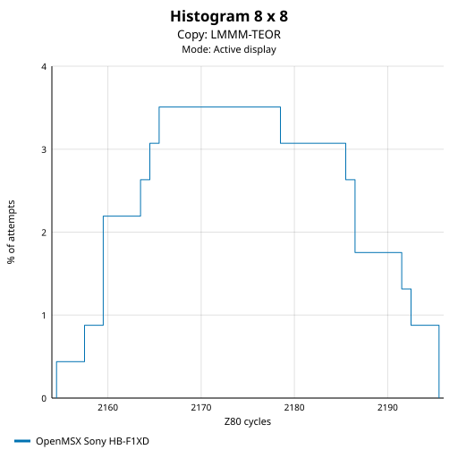</a>

**No sprites**

&nbsp;&nbsp;<a href="img/cycles_no-sprites_copy-lmmm-teor_deviation.svg">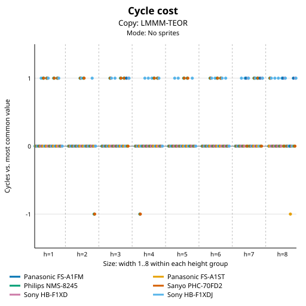</a>&nbsp;&nbsp;<a href="img/hist_8x8_no-sprites_copy-lmmm-teor.svg">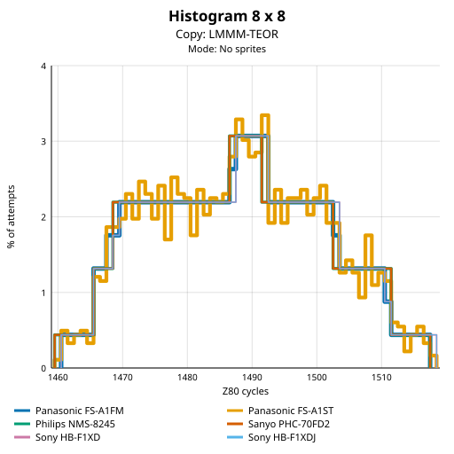</a>&nbsp;&nbsp;<a href="img_openmsx/hist_8x8_no-sprites_copy-lmmm-teor.svg">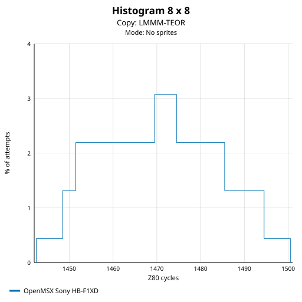</a>

**No display**

<a href="img/cycles_no-display_copy-lmmm-teor_shape.svg">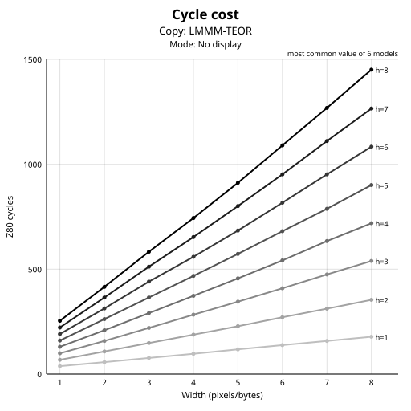</a>&nbsp;&nbsp;<a href="img/cycles_no-display_copy-lmmm-teor_deviation.svg">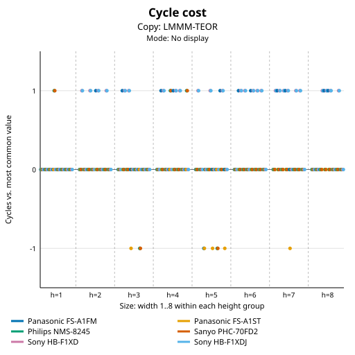</a>&nbsp;&nbsp;<a href="img/hist_8x8_no-display_copy-lmmm-teor.svg">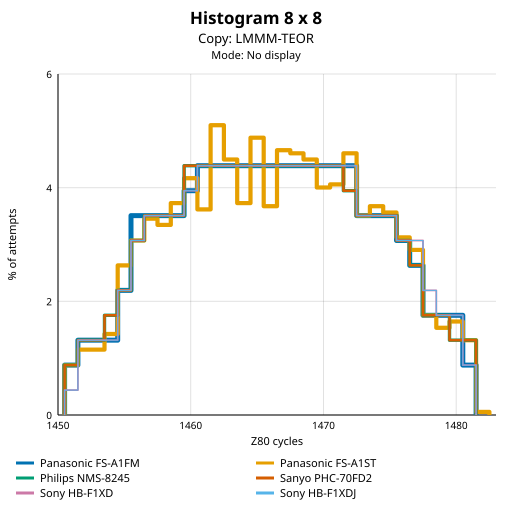</a>&nbsp;&nbsp;<a href="img_openmsx/hist_8x8_no-display_copy-lmmm-teor.svg">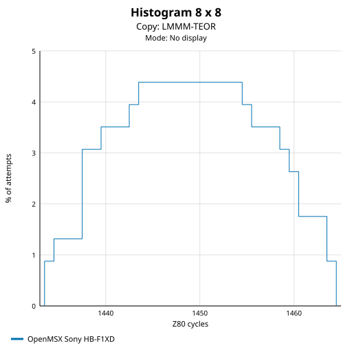</a>

## Copy: HMMM

**Active display**

<a href="img/cycles_active-display_copy-hmmm_shape.svg">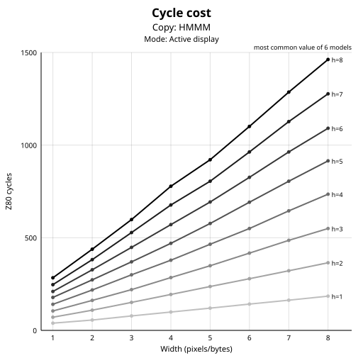</a>&nbsp;&nbsp;<a href="img/cycles_active-display_copy-hmmm_deviation.svg">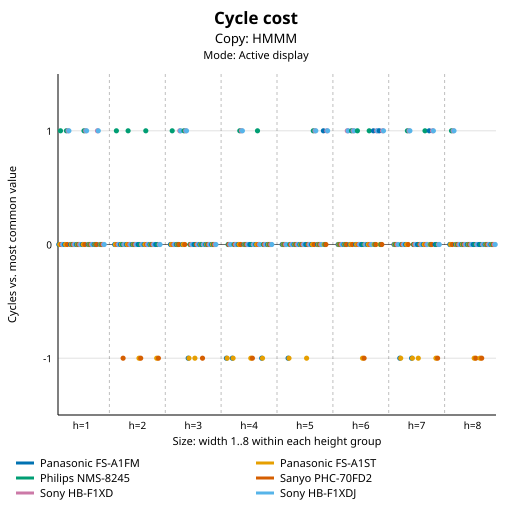</a>&nbsp;&nbsp;<a href="img/hist_8x8_active-display_copy-hmmm.svg">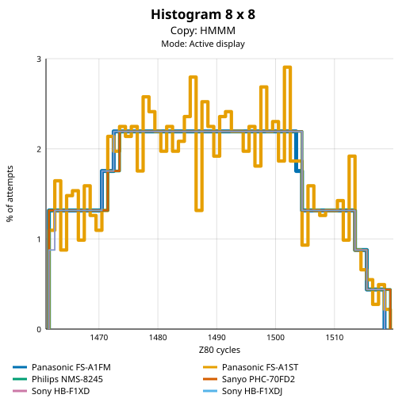</a>&nbsp;&nbsp;<a href="img_openmsx/hist_8x8_active-display_copy-hmmm.svg">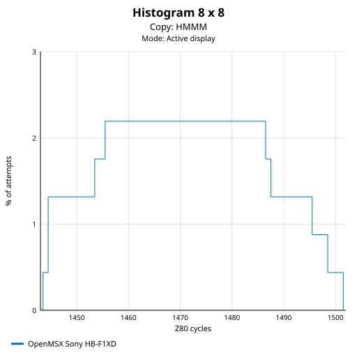</a>

**No sprites**

<a href="img/cycles_no-sprites_copy-hmmm_shape.svg">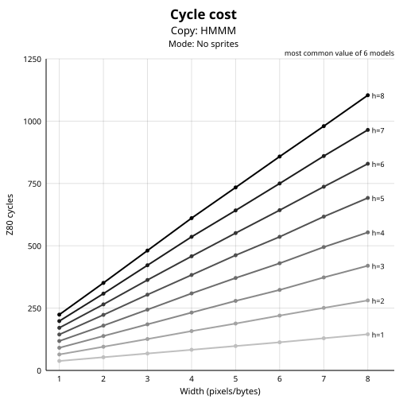</a>&nbsp;&nbsp;&nbsp;&nbsp;<a href="img/hist_8x8_no-sprites_copy-hmmm.svg">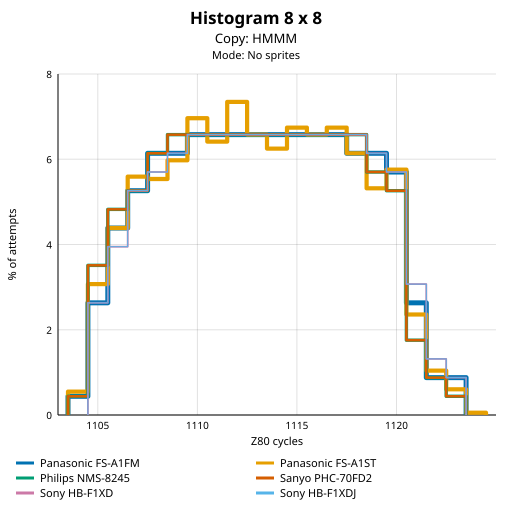</a>&nbsp;&nbsp;<a href="img_openmsx/hist_8x8_no-sprites_copy-hmmm.svg">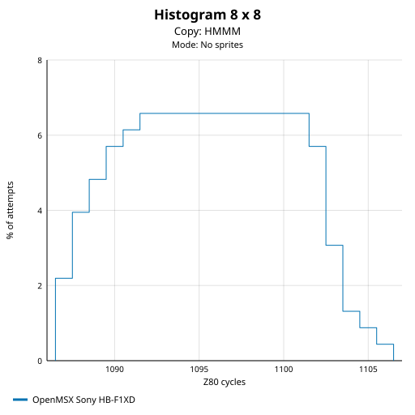</a>

**No display**

<a href="img/cycles_no-display_copy-hmmm_shape.svg">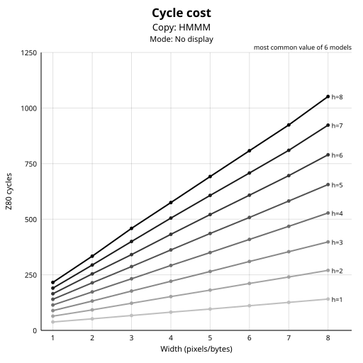</a>&nbsp;&nbsp;<a href="img/cycles_no-display_copy-hmmm_deviation.svg">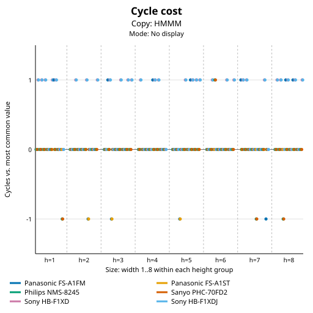</a>&nbsp;&nbsp;<a href="img/hist_8x8_no-display_copy-hmmm.svg">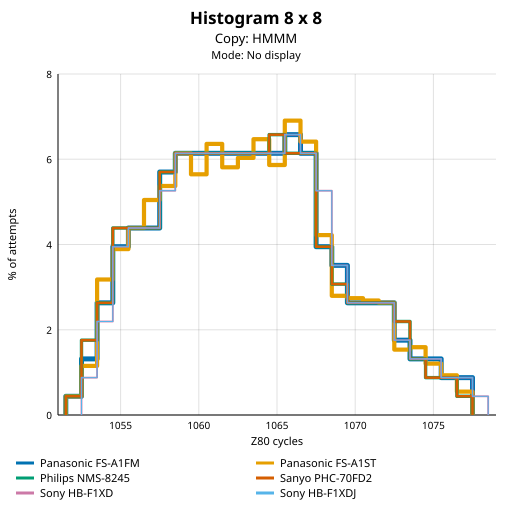</a>&nbsp;&nbsp;<a href="img_openmsx/hist_8x8_no-display_copy-hmmm.svg">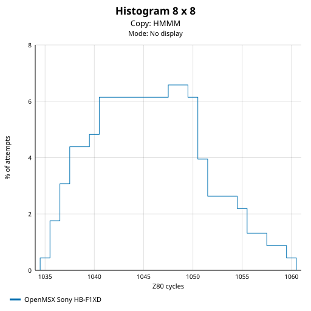</a>

## Copy: YMMM

**Active display**

<a href="img/cycles_active-display_copy-ymmm_shape.svg">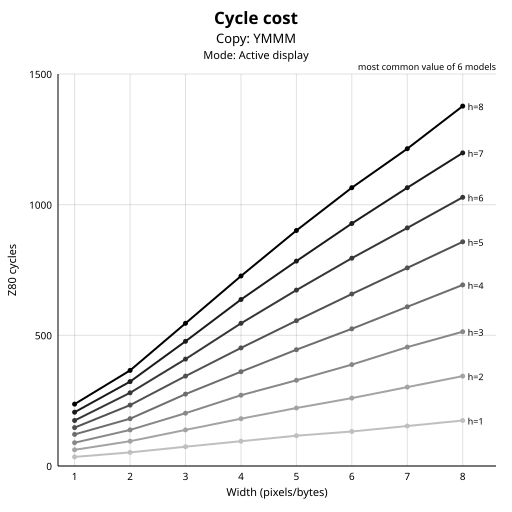</a>&nbsp;&nbsp;<a href="img/cycles_active-display_copy-ymmm_deviation.svg">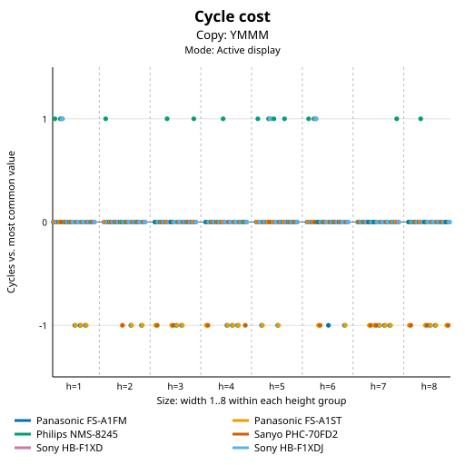</a>&nbsp;&nbsp;<a href="img/hist_8x8_active-display_copy-ymmm.svg">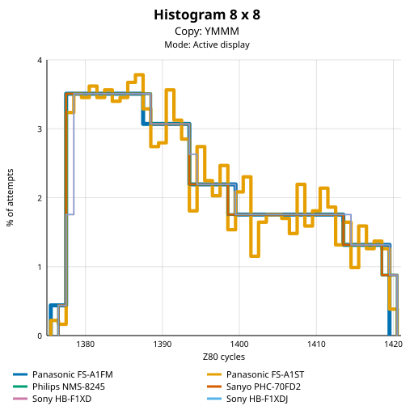</a>&nbsp;&nbsp;<a href="img_openmsx/hist_8x8_active-display_copy-ymmm.svg">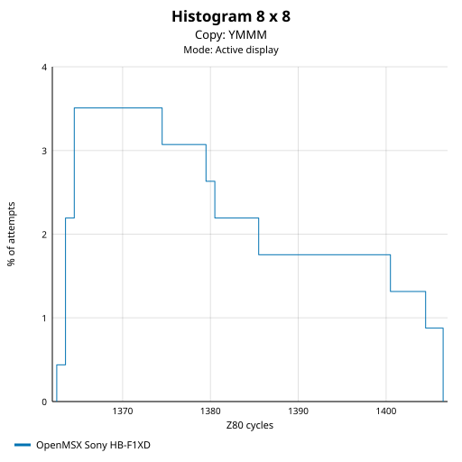</a>

**No sprites**

&nbsp;&nbsp;&nbsp;&nbsp;<a href="img/hist_8x8_no-sprites_copy-ymmm.svg">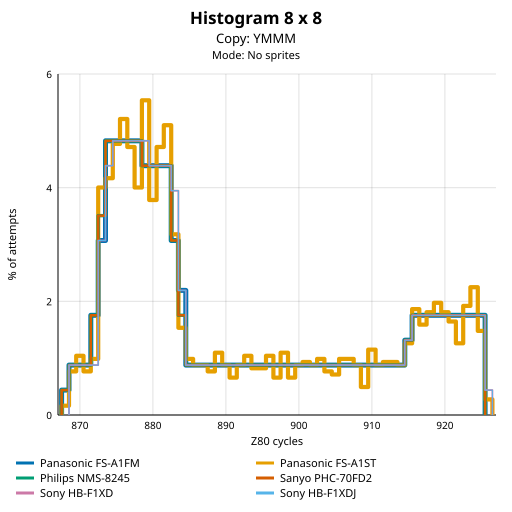</a>&nbsp;&nbsp;<a href="img_openmsx/hist_8x8_no-sprites_copy-ymmm.svg">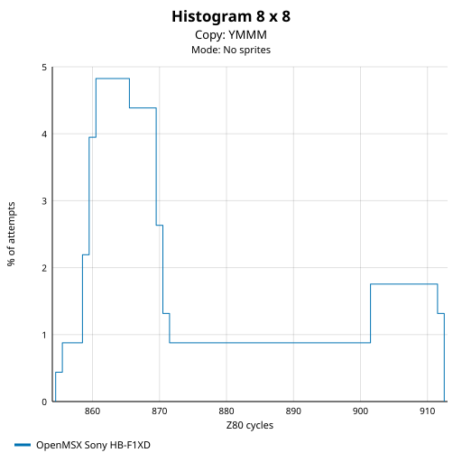</a>

**No display**

&nbsp;&nbsp;<a href="img/cycles_no-display_copy-ymmm_deviation.svg">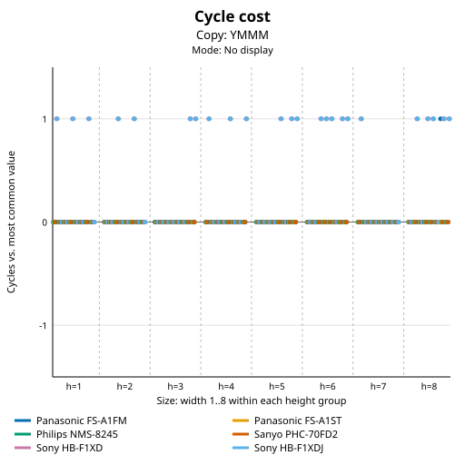</a>&nbsp;&nbsp;<a href="img/hist_8x8_no-display_copy-ymmm.svg">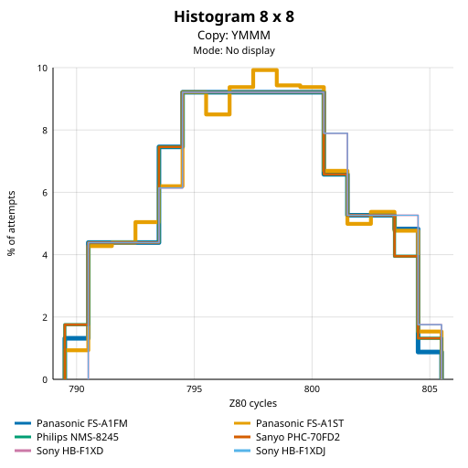</a>&nbsp;&nbsp;<a href="img_openmsx/hist_8x8_no-display_copy-ymmm.svg">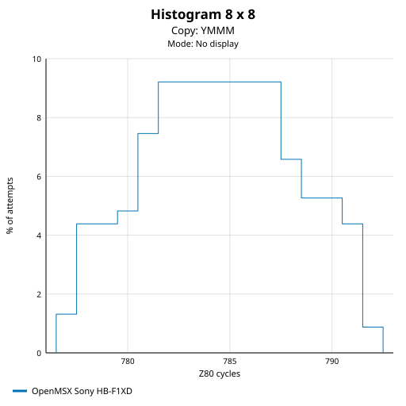</a>

## Fill: HMMV

**Active display**

<a href="img/cycles_active-display_fill-hmmv_shape.svg">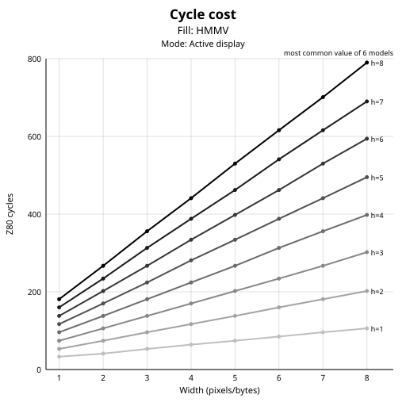</a>&nbsp;&nbsp;<a href="img/cycles_active-display_fill-hmmv_deviation.svg">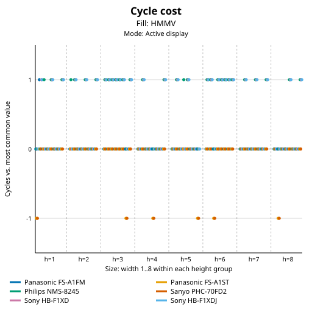</a>&nbsp;&nbsp;<a href="img/hist_8x8_active-display_fill-hmmv.svg">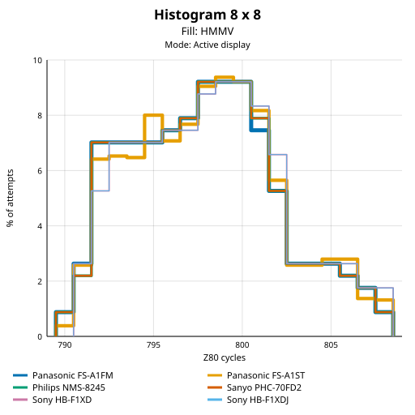</a>&nbsp;&nbsp;<a href="img_openmsx/hist_8x8_active-display_fill-hmmv.svg">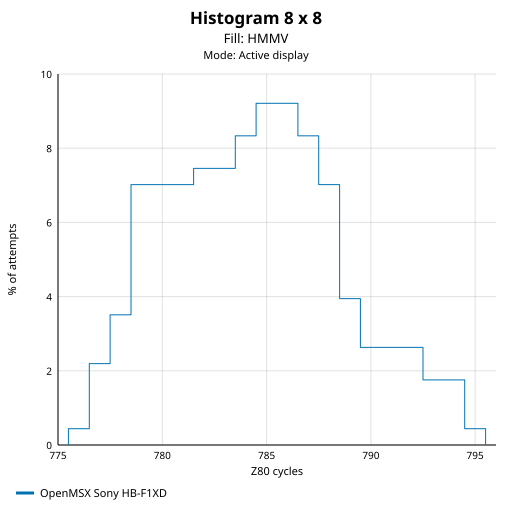</a>

**No sprites**

<a href="img/cycles_no-sprites_fill-hmmv_shape.svg">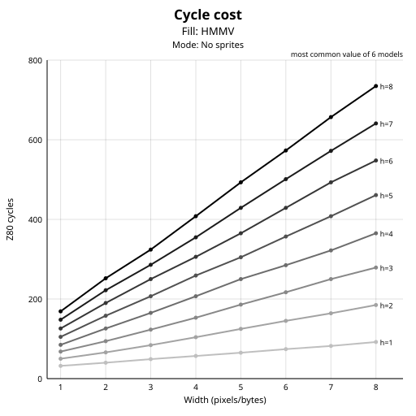</a>&nbsp;&nbsp;<a href="img/cycles_no-sprites_fill-hmmv_deviation.svg">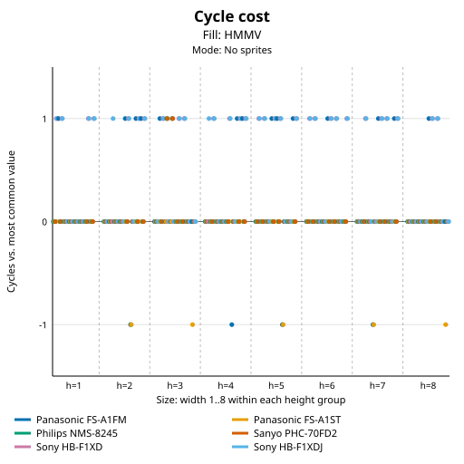</a>&nbsp;&nbsp;<a href="img/hist_8x8_no-sprites_fill-hmmv.svg">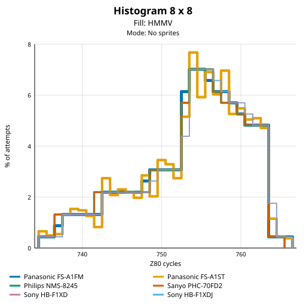</a>&nbsp;&nbsp;<a href="img_openmsx/hist_8x8_no-sprites_fill-hmmv.svg">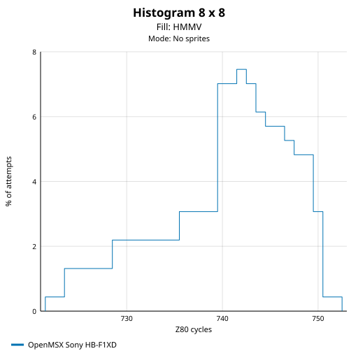</a>

**No display**

<a href="img/cycles_no-display_fill-hmmv_shape.svg">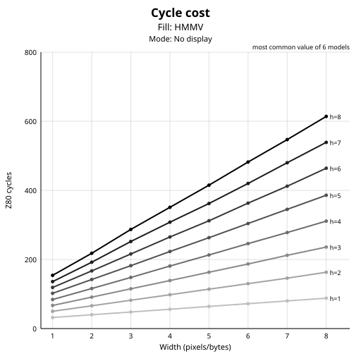</a>&nbsp;&nbsp;<a href="img/cycles_no-display_fill-hmmv_deviation.svg">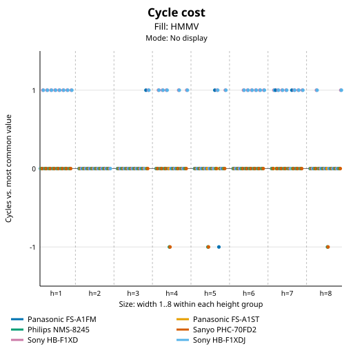</a>&nbsp;&nbsp;<a href="img/hist_8x8_no-display_fill-hmmv.svg">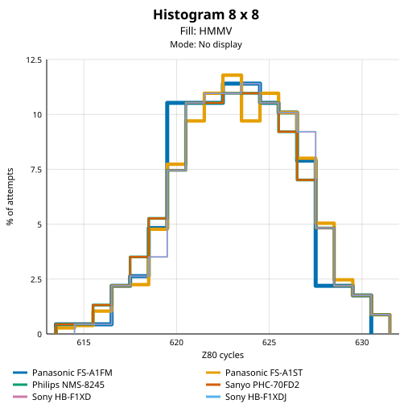</a>&nbsp;&nbsp;<a href="img_openmsx/hist_8x8_no-display_fill-hmmv.svg">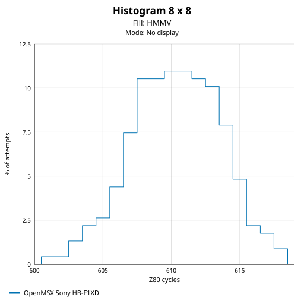</a>

## Fill: LMMV

**Active display**

<a href="img/cycles_active-display_fill-lmmv_shape.svg">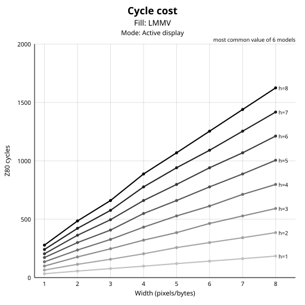</a>&nbsp;&nbsp;<a href="img/cycles_active-display_fill-lmmv_deviation.svg">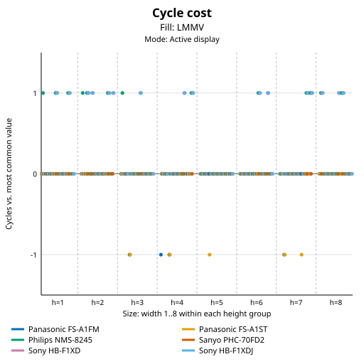</a>&nbsp;&nbsp;<a href="img/hist_8x8_active-display_fill-lmmv.svg">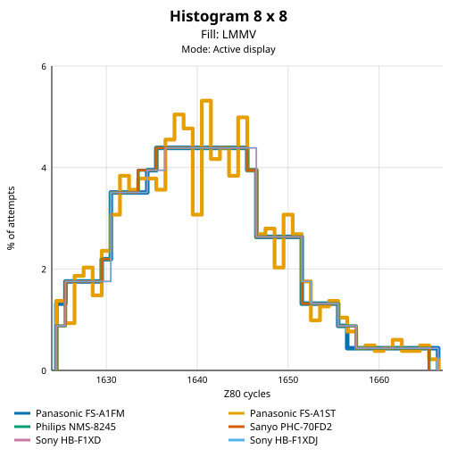</a>&nbsp;&nbsp;<a href="img_openmsx/hist_8x8_active-display_fill-lmmv.svg">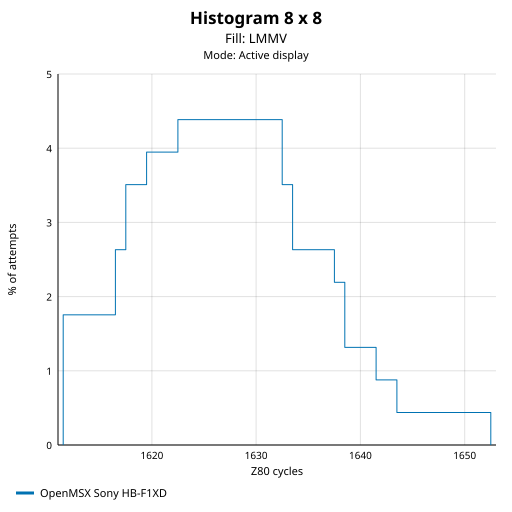</a>

**No sprites**

&nbsp;&nbsp;<a href="img/cycles_no-sprites_fill-lmmv_deviation.svg">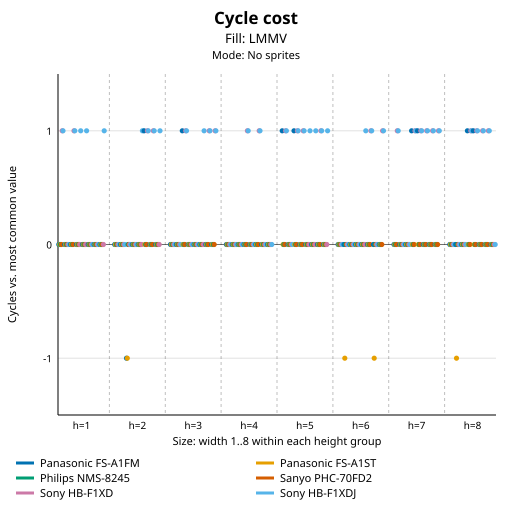</a>&nbsp;&nbsp;<a href="img/hist_8x8_no-sprites_fill-lmmv.svg">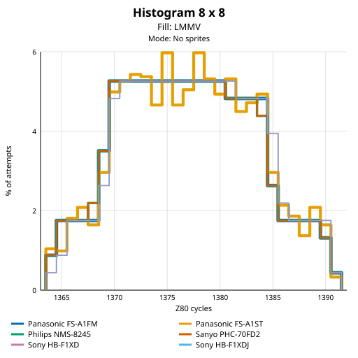</a>&nbsp;&nbsp;<a href="img_openmsx/hist_8x8_no-sprites_fill-lmmv.svg">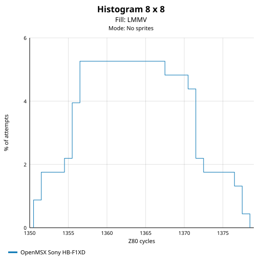</a>

**No display**

<a href="img/cycles_no-display_fill-lmmv_shape.svg">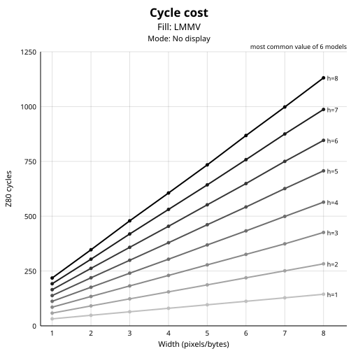</a>&nbsp;&nbsp;<a href="img/cycles_no-display_fill-lmmv_deviation.svg">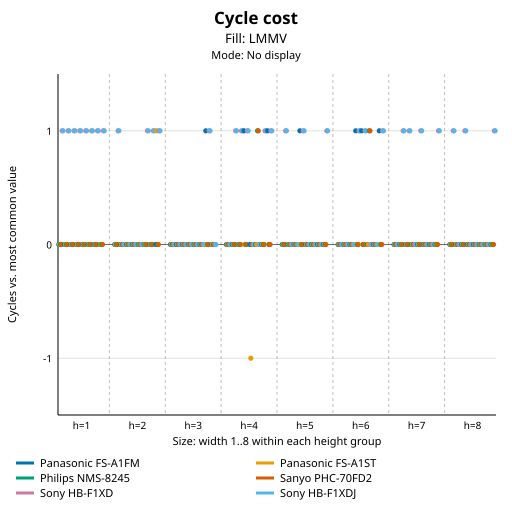</a>&nbsp;&nbsp;<a href="img/hist_8x8_no-display_fill-lmmv.svg">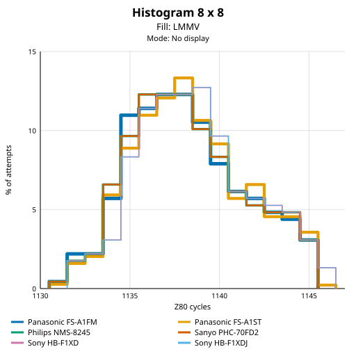</a>&nbsp;&nbsp;

## Line: LINE-TEOR

**Active display**

&nbsp;&nbsp;&nbsp;&nbsp;&nbsp;&nbsp;

**No sprites**

&nbsp;&nbsp;&nbsp;&nbsp;&nbsp;&nbsp;

**No display**

&nbsp;&nbsp;&nbsp;&nbsp;&nbsp;&nbsp;

